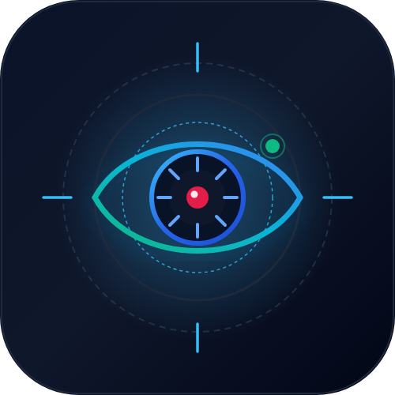

<div lang="fa" dir="rtl" align="right">

<p align="center">
  
</p>

# سامانه هوشمند تحلیل داده و دیده‌بانی سئو فَرادید (Faradid)
### Sahand Faradid — Enterprise SEO Intelligence, Deep Comparative Analytics & Executive Audit Suite

<p align="center">
  
  
  
  
  
</p>

---

## 👁‍🗨 فلسفه و معنای نام «فَرادید»

نام **«فَرادید» (Faradid)** از پیوند دو واژه اصیل و فاخر پارسی شکل گرفته است:
- **«فَرا»:** پیشوند برتری، فراسوی مرزهای عادی، ژرف‌نگری و افق‌گشایی نامحدود.
- **«دید»:** بینش، بصیرت، نگاه انسانی، نظاره حقیقت و تمیز دادن فرصت‌ها از تهدیدها.

> **شعار بنیادین فرادید:** *«دیده‌بانی عمیق داده‌ها، تصمیم‌گیری آگاهانه انسان‌ها، تسخیر هوشمندانه بازارها»*  
> فرادید سامانه‌ای است طراحی‌شده برای **انسان‌ها**؛ تا مدیران با زبان شفاف کسب‌وکار سخن بگویند، کارشناسان سئو تا ریزترین بایت‌های بودجه خزش و شکاف کلمات کلیدی را زیر ذره‌بین ببرند، و مشتریان مسیر رشد سرمایه‌گذاری خود را در نمودارهای شفاف لمس کنند.

---

## 🌟 قابلیت‌های بنیادین سامانه فَرادید

### ۱. ویزارد جامع تعریف پروژه و چندکاناله داده‌ها
- **دریافت هویت کسب‌وکار:** نام پروژه، دامنه اصلی، مدیرعامل/کارفرما، حوزه تخصصی صنعت.
- **اسکن اختیاری سورس‌کد لوکال:** بازرسی خودکار پوشه پروژه کاربر روی هارد دیسک (پایش Web.config، ریدایرکت‌های ۳۰۱، کدهای خطا و متاتگ‌ها).
- **اتصال دوگانه گوگل سرچ کنسول (GSC):** پشتیبانی از اتصال زنده API با Service Account، لاگین مستقیم OAuth گوگل، یا آپلود ساده فایل‌های JSON/CSV خروجی کنسول.
- **انتخاب مسیر دلخواه خروجی:** امکان تعیین پوشه مقصد توسط کاربر روی سیستم جهت ذخیره فایل‌های PDF و HTML.

### ۲. موتور تحلیل مقایسه‌ای عمیق (Comparative Analytics Engine)
- **مقایسه‌های زمانی نامحدود:** ماه جاری نسبت به ماه گذشته (MoM)، فصلی، سالانه نسبت به سال قبل (YoY)، و دوره‌های تاریخی بحران (مانند تحلیل افت ترافیک در شرایط اختلالات اینترنت و فیلترشکن).
- **تفکیک ترافیک آی‌پی:** آنالیز دقیق نوسانات کاربران با آی‌پی واقعی ایران در برابر ترافیک با IP کشورهای اروپایی.

### ۳. ماتریس کالبدشکافی رقبا و استراتژی ضدحمله (Competitor Landscape)
- شناسنامه تفصیلی رقبای مستقیم بازار همراه با برآورد ترافیک، رتبه میانگین SERP و سهم بازار ارگانیک.
- تحلیل ریشه‌ای دلایل برتری (Leading) و عقب‌ماندگی (Lagging) در ۶ بعد حیاتی:
  1. سابقه و سن تاریخی دامنه
  2. سئوی تکنیکال و شاخص‌های حیاتی هسته وب (Core Web Vitals)
  3. کیفیت، عمق محتوا و راهنماهای کاربردی
  4. نرخ تبدیل کلیک به تماس و ثبت لید (CRO)
  5. سیگنال‌های محلی و پک سه‌تایی نقشه گوگل (Local Map Pack)
  6. اعتماد، شفافیت قیمت و مجوزهای رسمی
- **تدوین خودکار کتابچه تاکتیک‌های ضدحمله سئو (Offensive Playbook).**

### ۴. تفکیک دیدگاه سه‌گانه مخاطبان (Multi-Persona Architecture)
- **دیدگاه کارشناس ارشد سئو (SEO Specialist):** ممیزی بودجه خزش، کانیبالیزیشن کلمات، سلامت کدهای اسکیما، انکرتکست‌های بک‌لینک و کلمات دم‌دراز.
- **دیدگاه کارفرما و مشتری (Client / Business Owner):** بدون اصطلاحات پیچیده؛ تمرکز بر تماس‌های دریافتی، رتبه‌های تسخیرشده، و بازگشت سرمایه (ROI).
- **دیدگاه مدیرعامل و هیئت‌مدیره (Executive / Board):** خلاصه راهبردی، سهم بازار، ارزیابی رقبا، نقشه راه ۹۰ روزه و کارنامه ۱۴ صفحه‌ای چاپی با ۳ امضا و مهر رسمی شرکت.

### ۵. هوش مصنوعی تحلیل‌گر و نگارنده (AI Copilot Integration)
- اتصال به APIهای نسل جدید هوش مصنوعی جهت نگارش خودکار تحلیل‌های انسانی، هشدارهای افت ترافیک، و تولید تقویم محتوایی ماه آینده منطبق با استانداردهای E-E-A-T.

### ۶. احراز هویت متمرکز راهکار الکترونیک سهند (Irres Gate SSO)
- امنیت سازمانی با پروتکل استاندارد OIDC / Central Auth و ورود با حساب کاربری متمرکز `auth.irres.ir`.

---

## 🏛 ساختار معماری و ماژول‌ها (.NET 10 / C# 14)

```
Faradid/
├── Faradid.slnx               # فایل مدرن سوشن دات‌نت ۱۰
├── src/
│   ├── Faradid.Web/           # پرتال وب، کنترلرها، ویوها و APIهای مینیمال
│   │   ├── Controllers/       # داشبورد، مدیریت پروژه‌ها، تولید گزارش
│   │   ├── Views/             # رابط کاربری با کنتراست بالا و کامپوننت‌های مدرن
│   │   └── wwwroot/           # استایل‌ها، فونت وزیرمتن و لوگوی فرادید
│   ├── Faradid.Core/          # مدل‌های داده، موجودیت‌های تحلیلی و اینترفیس‌ها
│   ├── Faradid.Engine/        # موتور پایش سرچ‌کنسول، سورس‌کد و محاسبات مقایسه‌ای
│   └── Faradid.AI/            # ماژول هوش مصنوعی، تحلیل کیفی و تولید استراتژی
└── README.md
```

---

<p align="center">
  <b>شرکت راهکار الکترونیک سهند (مسئولیت محدود • ثبت ۳۲۹۹۵)</b><br/>
  پرتال مرکزی: <a href="https://irres.ir">https://irres.ir</a> | ساب‌دامنه سامانه: <a href="https://faradid.irres.ir">faradid.irres.ir</a>
</p>

</div>
